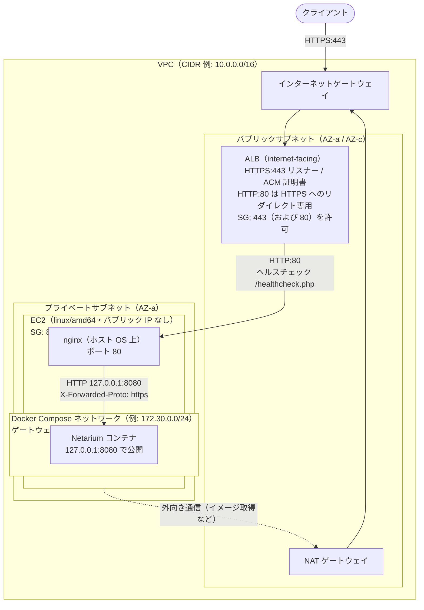

# AWS の ALB + EC2 構成で Docker 版を運用する場合の留意点

Netarium の Docker 版を AWS 環境で運用する場合の参考構成と留意点を示します。
本ドキュメントは AWS 上での実機配備を伴う検証を行っていない参考構成であり、管理者が実環境に応じた受入確認を実施する必要があります。

アプリケーションの基本的な配備手順は [Docker / Linux Compose 配備・運用ガイド](deployment-docker.md) に従います。
本ドキュメントでは AWS 環境における差分のみを説明します。

## 構成概要

Netarium は単一ホストのファイルシステム上に配置した SQLite データベースで動作します。
Auto Scaling やマルチ AZ（アベイラビリティゾーン）による複数インスタンスへの分散配置には対応していません。
そのため、EC2 インスタンス上で単一の Docker Compose 構成として稼働させ、障害発生時はバックアップからの復元で対応します。
EC2 インスタンスのプラットフォームには、公式 Docker イメージと同じ `linux/amd64` を選択します。

インターネット経由の通信は、原則として HTTPS を使用します。
前段に **ALB**（Application Load Balancer）を配置し、クライアントからの TLS 通信を ALB で終端します。
Netarium は `config/app.php` の `trusted_https_proxies` に登録した IP アドレスからの接続でのみ `X-Forwarded-Proto: https` を信頼し、HTTPS 通信として認識します。
この登録は IP アドレスの完全一致のみを受け付け、CIDR 表記やホスト名は指定できません。
ALB は IP アドレスが固定されず定期的に変動するため、ALB の IP アドレスを直接 `trusted_https_proxies` に登録することはできません。
そこで、EC2 ホスト上にリバースプロキシとして nginx を常駐させ、接続元 IP アドレスが固定される経路を構成します。

### 参考ネットワーク構成



## AWS リソースの設計

### ネットワークとセキュリティグループ

ALB はパブリックサブネットに配置し、EC2 インスタンスはプライベートサブネットに配置します。
EC2 インスタンスにはパブリック IP アドレスを付与しません。
EC2 インスタンスからコンテナイメージの取得などを行う外向き通信は、NAT ゲートウェイを経由させます。

ALB のセキュリティグループでは、インバウンドとして HTTPS（ポート 443）を許可します。
HTTP（ポート 80）のリスナーを設ける場合はポート 80 も許可します。

EC2 インスタンスのセキュリティグループでは、HTTP（ポート 80）のインバウンドを ALB のセキュリティグループからのみ許可します。
その他の経路からのアクセスを遮断します。

Netarium コンテナのポート公開設定は `127.0.0.1:8080` を維持し、ホスト外へ直接公開しません。

EC2 インスタンスへの保守接続には、EC2 Instance Connect エンドポイントまたは AWS Systems Manager Session Manager を使用し、SSH（ポート 22）をインターネットへ直接公開しません。

### ALB とターゲットグループの設定

HTTPS:443 リスナーで TLS を終端し、ACM（AWS Certificate Manager）等で管理する証明書を適用します。
HTTP:80 で要求を受け付ける場合は、バックエンドへ転送せず、HTTPS:443 へのリダイレクト専用リスナーとして設定します。
HTTP のままバックエンドへ転送するリスナーを設けてはなりません。

ALB のアイドルタイムアウト属性は 300 秒以上に設定します。
デフォルトの 60 秒では、PHP の `max_execution_time`（300 秒）や Ping 実行の最大待ち時間（120 秒）に満たず、時間のかかる処理の途中で ALB が接続を切断する原因となります。

ターゲットグループのプロトコルは HTTP、ポートは 80（ホスト上の nginx）を指定します。
ヘルスチェックのパスには `/healthcheck.php` を指定し、正常コードに `200` を設定します。

`/healthcheck.php` は Web サーバーの応答性、ストレージの書込可能性、および既存 DB の読み取り疎通を確認します。
データベースファイルが存在しない未セットアップ状態でも `200 OK` を返す仕様です。
そのため、ALB のヘルスチェックが成功している事実は、初期セットアップの完了、クライアントと ALB 間の TLS 接続、および Netarium による HTTPS 判定の成立を証明するものではありません。

## リバースプロキシ（nginx）の設定

Netarium は `config/app.php` の `trusted_https_proxies` に登録した IP アドレスからの接続でのみ `X-Forwarded-Proto` を信頼します。
詳細は [配備ガイド](deployment.md#csphstsセッションcookieの設定202) を参照してください。

ホスト OS 上にパッケージマネージャ等で nginx を導入し、設定を配置します。
コンテナとして nginx を動かすと、接続元 IP アドレスが別のコンテナのものとなり本構成の設定と合致しません。

```nginx
server {
    listen 80 default_server;
    server_name _;

    client_max_body_size 34m;

    location / {
        proxy_pass http://127.0.0.1:8080;
        proxy_http_version 1.1;
        proxy_set_header Host $host;
        # 受信した X-Forwarded-Proto は破棄し、固定値 https を設定する
        proxy_set_header X-Forwarded-Proto https;
        proxy_read_timeout 300s;
        proxy_send_timeout 300s;
    }
}
```

### X-Forwarded-Proto 固定値上書きのセキュリティ境界

nginx の設定で `proxy_set_header X-Forwarded-Proto https;` を指定する目的は、外部クライアントから送られた偽装ヘッダーを排除し、ALB で TLS を終端済みであることを Netarium コンテナへ伝達することです。

この固定値上書きは、セキュリティグループの設定誤り等による直接 HTTP 到達からアプリケーションを保護する対策ではありません。
もしセキュリティグループの設定不備などにより、ALB を経由しない平文 HTTP 通信が nginx に直接到達した場合、nginx はその通信に対しても無条件で `X-Forwarded-Proto: https` を付与します。
その結果、Netarium は暗号化されていない平文通信を HTTPS と誤認して処理します。

したがって、前述のとおり EC2 インスタンスのセキュリティグループで ALB 以外からのポート 80 への到達を遮断すること、および Netarium コンテナのバインド先を `127.0.0.1` に限定することが前提となります。

## Docker Compose ネットワークと設定ファイルの作成

### ネットワークサブネットの固定

ホスト OS の nginx から `127.0.0.1:8080` を経由してコンテナへ要求を転送する場合、一般的な Linux Docker Engine の bridge ネットワーク環境では、デフォルトネットワークのゲートウェイ IP アドレスが接続元（`REMOTE_ADDR`）として観測される構成例が多く見られます。
ただし、コンテナランタイムやネットワーク機構によって実際の観測値は異なる場合があるため、接続元がゲートウェイになると断言することはできません。
接続元 IP アドレスの範囲が環境再作成時に変わる事態を防ぐため、Compose ファイルでサブネットとゲートウェイを固定します。

利用する Compose ファイル（方式 A は `compose.yaml`、方式 B は `compose.image.yaml`）に以下のネットワーク設定を追加します。

```yaml
networks:
  default:
    ipam:
      config:
        - subnet: 172.30.0.0/24
          gateway: 172.30.0.1
```

指定するサブネットは、VPC の CIDR や接続先のネットワークと重複しない範囲を選択します（AWS のデフォルト VPC は `172.31.0.0/16` です）。
管理スクリプト `scripts/docker-update.sh` は `-f` で単一の Compose ファイルを指定して実行するため、`compose.override.yaml` による自動設定マージを利用できません。
Compose ファイルを直接修正し、方式 A での `git pull` や、方式 B での `image:` タグ更新の際に、この変更差分を破棄しないよう管理します。

### `config/app.php` の作成とマウント

`config/app.php` を作成し、信頼するプロキシの IP アドレスと HSTS の設定を記述します。

```php
<?php
declare(strict_types=1);

return [
    'trusted_https_proxies' => ['172.30.0.1'],
    'hsts_max_age' => 300,
];
```

上記の設定値 `172.30.0.1` は構成例です。
後述の受入確認に従い、実際の環境でコンテナが観測した接続元 IP アドレスの完全一致文字列を登録します。
CIDR やホスト名は指定できません。
不要な IP アドレスを追加してはなりません。

[配備ガイド](deployment.md#csphstsセッションcookieの設定202) の方針に従い、最初から長期の値を指定せず `hsts_max_age => 300` 等の短い秒数から開始します。
HTTPS 接続と証明書更新を確認した後に、段階的に値を延長します。
HSTS を解除する場合は、有効な HTTPS 接続を維持したまま `hsts_max_age => 0` を送信し、ブラウザの記憶を解除したことを確認してから無効化します。
なお、この設定による HSTS は PHP スクリプトの応答にのみ適用され、静的ファイルを含む応答全体に付与されるわけではありません。

作成した `config/app.php` をコンテナに読み取り専用でマウントするため、Compose ファイルの `volumes` に設定を追加します。
手順の詳細は [Docker / Linux Compose 配備・運用ガイド](deployment-docker.md#5-https--リバースプロキシ構成) を参照してください。

```yaml
    volumes:
      - netarium_data:/var/lib/netarium
      - ./config/app.php:/var/www/html/config/app.php:ro
```

## 配備後の受入確認

環境の構築後、管理者は以下の項目を検証して配備の妥当性を確認します。

1. **接続元 IP アドレスの合致**：
   コンテナ内のアクセスログ等を確認し、PHP が実際に観測する接続元 IP（`REMOTE_ADDR`）が `trusted_https_proxies` に登録した値と完全に一致していることを確認します。
2. **HTTPS セッション Cookie の発行**：
   ブラウザから ALB 経由で HTTPS アクセスし、ログイン画面等で発行されるセッション Cookie 名が `__Host-netarium_session` であり、`Secure` 属性が付与されていることを確認します。HTTP 判定のまま動作している場合、Cookie 名は `netarium_session`（`Secure` 属性なし）となります。
3. **セキュリティヘッダーの確認**：
   ブラウザの開発者ツールや curl 等で、PHP の応答ヘッダーに設定した `Strict-Transport-Security` が含まれていることを確認します。

## 既知の制約

Netarium は接続元の識別に `REMOTE_ADDR` を使用します。
本構成ではすべての利用者の接続元がリバースプロキシの IP アドレス（例: `172.30.0.1`）として集約されるため、以下の留意点があります。

- **パスワードスプレー検知**：異なる利用者の認証失敗が同一の接続元として集約して集計されるため、警告ログが記録されやすくなります。ただし、これによって利用者のアカウントや共有 IP アドレスが自動的にロックアウトされることはありません。
- **アクセスログ**：コンテナ内の Apache ログに記録される接続元も集約されます。クライアント固有の IP アドレスを調査する必要がある場合は、ALB のアクセスログを有効化し、通信時刻と照合して特定します。
