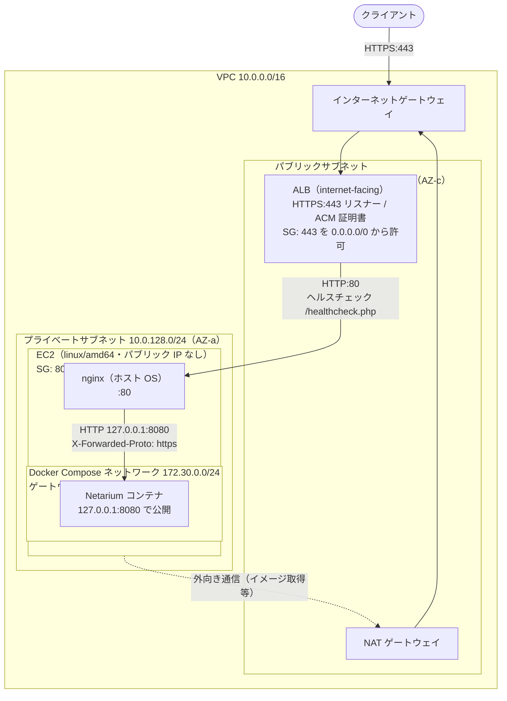

# AWS の ALB + EC2 構成で Docker 版を運用する場合の留意点

Netarium の Docker 版を AWS 環境で運用する場合の構成案と留意点を以下のとおり整理します。

アプリケーションのデプロイ等の運用手順は [Docker / Linux 配備・運用ガイド](deployment-docker.md) に従い、本ドキュメントはその手順を AWS 環境で実施する場合の差分のみを範囲とします。

## 構成案

```text
クライアント
   ↓ HTTPS:443（TLS 終端）
ALB（HTTP のままバックエンドへ転送するリスナーは設けない）
   ↓ HTTP:80（SG で ALB からのみ許可）
EC2（プライベートサブネット）
   nginx（ホスト OS 上）
      ↓ HTTP 127.0.0.1:8080
   Netarium コンテナ（Docker Compose）
```

- Netarium は単一ホスト・単一ボリュームの SQLite で動作する構成のため、ECS (Fargate) ではなく EC2 上で Docker Compose を実行する構成とします。
- 公式イメージと同様に、EC2 のプラットフォームは linux/amd64 とします。
- Netarium はクライアントから HTTPS で接続することが原則であるため、EC2 の前段に ALB を配置し、クライアントからの HTTPS 通信を ALB で終端させます。
- HTTPS を前段のロードバランサーなどで終端する構成では、Netarium は `config/app.php` の `trusted_https_proxies` に登録した IP アドレスからの接続に限り `X-Forwarded-Proto` を信頼し、HTTPS と判定します。登録は IP アドレスの完全一致のみで、CIDR やホスト名は指定できません。
- しかし AWS の ALB は仕様上 IP アドレスが固定されず、定期的に変更されるため、ALB の IP アドレスを `trusted_https_proxies` に登録して運用することはできません。そこで、ALB と Netarium の間に接続元 IP アドレスが固定されるリバースプロキシーを挟んで対応します。
- 具体的には EC2 のホスト OS 上に nginx を構築し、ALB → nginx → Netarium となるよう構成します。

### 参考構成（ネットワーク）

ネットワーク構成例を以下に示します。CIDR は一例であり、Docker Compose のサブネット（`172.30.0.0/24`）と重複しなければ任意です。



## リバースプロキシー（nginx）の設定

Netarium は `config/app.php` の `trusted_https_proxies` に登録した IP アドレスからの接続でのみ `X-Forwarded-Proto` を信頼する設計です（[配備ガイド](deployment.md#csphstsセッションcookieの設定) を参照）。

EC2 のホスト OS 上に nginx を立て、公開ポート `127.0.0.1:8080` を経由してコンテナへ転送すると、Netarium から見たリモートアドレス（`REMOTE_ADDR`）は Docker Compose のデフォルトネットワークのゲートウェイ IP アドレスになります。この IP アドレスを `trusted_https_proxies` に登録することで、HTTPS として正常に接続できるようになります。

**注**: nginx はコンテナではなく、ホスト OS にパッケージでインストールしてください。nginx を Compose のサービスとしてコンテナで動かすと、Netarium から見た接続元は nginx コンテナの IP アドレスとなり、本ドキュメントの設定値とは一致しません。

### Docker Compose のデフォルトネットワークのサブネットを固定

Docker Compose のデフォルトネットワークのサブネットを固定しないと、ゲートウェイ IP アドレスが環境によって変わってしまうため、都度 `config/app.php` に登録する IP アドレスを変更しなければなりません。

そのため、使用する Compose ファイル（方式 A は `compose.yaml`、方式 B は `compose.image.yaml`）に以下を追加します。

```yaml
networks:
  default:
    ipam:
      config:
        - subnet: 172.30.0.0/24
          gateway: 172.30.0.1
```

- サブネットは、VPC の CIDR や、VPC ピアリング・VPN 等で接続する先のネットワークと重複しない範囲を選んでください。重複すると、ホストからその範囲へ通信できなくなります（デフォルト VPC は `172.31.0.0/16` です）。
- `scripts/docker-update.sh` 等の管理スクリプトは `-f` で 1 つの Compose ファイルのみを受け付けるため、`compose.override.yaml` による追加設定は使用できません。Compose ファイルを直接修正し、方式 A では `git pull` 時に、方式 B では `image:` のタグを書き換える際に、この差分が失われないよう管理してください。

### `config/app.php` の作成

上記で設定したゲートウェイ IP アドレスを登録します。

```php
<?php
declare(strict_types=1);

return [
    'trusted_https_proxies' => ['172.30.0.1'],
    'hsts_max_age' => 31536000,
];
```

作成した `config/app.php` をコンテナへマウントする手順は、[Docker / Linux 配備・運用ガイド「5. HTTPS / リバースプロキシ構成」](deployment-docker.md#5-https--リバースプロキシ構成) のとおりです。

### nginx の設定

```nginx
server {
    listen 80 default_server;
    server_name _;

    client_max_body_size 34m;

    location / {
        proxy_pass http://127.0.0.1:8080;
        proxy_http_version 1.1;
        proxy_set_header Host $host;
        # 受信した値は破棄し、単一の値で上書きする（ALB は HTTPS リスナーからのみ転送する前提）
        proxy_set_header X-Forwarded-Proto https;
        proxy_read_timeout 300s;
        proxy_send_timeout 300s;
    }
}
```

- [配備ガイド](deployment.md#csphstsセッションcookieの設定) のとおり、TLS 終端プロキシーは受信した `X-Forwarded-Proto` を破棄して単一の値へ上書きする必要があります。ALB 自体も同ヘッダーを上書きしますが、nginx 側でも固定値を設定しておくことで、セキュリティグループの設定誤り等により ALB 以外から nginx へ到達した場合でも、偽装されたヘッダーが信頼されることを防ぎます。
- この設定は、ALB が HTTPS:443 リスナーからのみバックエンドへ転送し、HTTP のまま転送するリスナーを設けないことを前提とします。

## AWS リソースの設定

### ネットワーク・セキュリティグループ

- ALB はパブリックサブネット、EC2 はプライベートサブネットに配置し、EC2 にはパブリック IP アドレスを割り当てません。EC2 からインターネットへの通信（イメージの取得等）は NAT ゲートウェイ経由とします。
- ALB のセキュリティグループでは、インバウンドを 443 番ポート（HTTP:80 リスナーを設ける場合は 80 番ポートも）に限定します。
- EC2 のセキュリティグループでは、80 番ポートへのインバウンドを ALB のセキュリティグループからのみ許可します。
- Netarium コンテナの公開ポートは `127.0.0.1:8080` のままとし、変更しません。
- EC2 への管理用接続は、EC2 Instance Connect エンドポイントまたは Systems Manager Session Manager を使用し、SSH をインターネットに公開しません。EC2 Instance Connect エンドポイントを使用する場合は、22 番ポートへのインバウンドをエンドポイントのセキュリティグループからのみ許可します。

### ALB

- HTTPS:443 リスナーで TLS を終端し、ACM の証明書を使用します。
- HTTP のままバックエンドへ転送するリスナーは設けません。HTTP:80 で受け付ける場合は、HTTPS:443 へのリダイレクト専用のリスナーとします。
- アイドルタイムアウトは 300 秒以上に変更します。デフォルトの 60 秒のままでは、PHP の `max_execution_time`（300 秒）や Ping の最大実行時間（120 秒）に満たず、時間のかかる処理が ALB でエラーとなります。

### ターゲットグループ

- プロトコルは HTTP、ポートは 80（nginx）とします。
- ヘルスチェックのパスは `/healthcheck.php`、成功コードは `200` とします。

### 可用性とバックアップ

- SQLite を使用する単一ホスト構成のため、Auto Scaling グループによる複数台構成やマルチ AZ での冗長化はできません。障害時はバックアップからの復旧を前提とします。

## 既知の制約

Netarium は接続元の判定に `REMOTE_ADDR` のみを使用するため、本構成では全ての利用者の接続元が `172.30.0.1` として扱われ、以下の影響があります。

- パスワードスプレー検知が全利用者の失敗を同一の接続元として集計するため、警告が発生しやすくなります。
- コンテナの Apache アクセスログに記録される接続元もすべて `172.30.0.1` となり、利用者の端末を特定できません。

クライアントの IP アドレスが必要な場合は、ALB のアクセスログを有効化し、時刻で突き合わせて確認してください。
